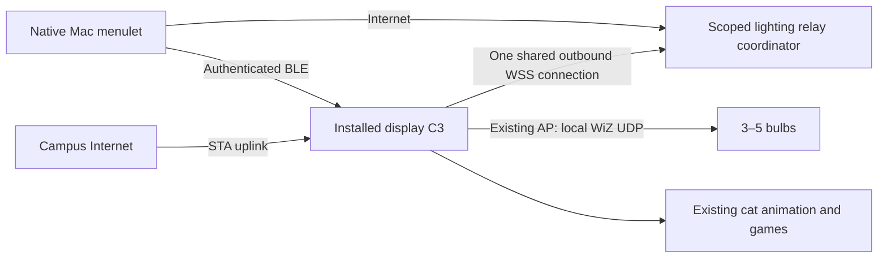

# Lighting gateway: architecture and feasibility

Research checkpoint: 16 November 2026. This is a proposed design, not a deployed
lighting service. No light, Wi-Fi configuration, production firmware or cloud
deployment was changed during this audit.

## Chosen topology: the installed display ESP32 only

The user has chosen the **installed ESP32-C3**, with **3–5 bulbs reset and joined
to its existing AP**. The spare remains a maintenance hub; a separate gateway,
private router and always-on Mac are not the implementation plan. The plan below
honors that constraint. It is a constrained, measurable integration, not a
claim that an untested BLE build already fits or cannot affect display timing.

No lighting status, pairing code, prompt or failure is drawn on the display.
The lighting worker has a separate bounded queue, registry and authority core;
the cat renderer and game simulation remain their existing owners. All traffic
still shares one CPU, heap, radio, power and reboot domain. Meeting the user's
no-interference requirement is therefore a release gate rather than structural
hardware isolation.

The ESP's campus uplink does **not** give its AP clients Internet access by
itself. The inspected configuration has `CONFIG_LWIP_IP_FORWARD` disabled and
no NAT path. The intended steady-state command path is local UDP; bulb-side
clock bootstrap, vendor-assisted commissioning and signing-key retention after
reset still require verification on the actual bulbs. A valid gateway clock
does not establish that a newly reset bulb accepts timestamped signed commands.
Do not silently add forwarding or change the campus/AP configuration to hide
this onboarding constraint.

## Measured constraints and the bounded integration path

At inspected revision `efb8c1f`, RC15 has 651,264 bytes of signed application
slot headroom. Its recorded minimum-ever heap is 28,588 bytes, only 4,588 above
the health guard's 24,000-byte boundary. `BT_ENABLED=false` in the existing
build. Its 133.898-second observation is not a combined lighting/BLE soak.
Flash capacity does not establish RAM or radio capacity.
[Health guard](../../components/entrance/health.c),
[recorded baseline](../validation.md),
[network implementation](../../components/entrance/network.c).

Espressif's C3 coexistence matrix labels SoftAP connecting/connected with BLE
as supported with unstable performance; STA-only combinations are better
qualified. APSTA's home channel follows the station, so campus reassociation
can move the bulb AP. C3 supports up to 15 AP stations subject to encryption
key allocation; this application currently allows four. These facts remain
true when all lighting code runs at a lower task priority.
[RF coexistence](https://docs.espressif.com/projects/esp-idf/en/v6.1/esp32c3/api-guides/coexist.html),
[Wi-Fi channels and station limits](https://docs.espressif.com/projects/esp-idf/en/v6.1/esp32c3/api-guides/wifi-driver/overview.html).

The candidate configuration raises AP capacity to **eight**: five bulbs, two
local players and one maintenance client. That is an allocation/test target,
not a claim eight clients are already stable. Keep the existing SSID, campus
credentials, fixed MACs and normal game routes. Do not switch the Mac's Wi-Fi.

Reuse **one** outbound TLS/WebSocket session. Add a versioned lighting channel
with independent role checks, allowlisted operations and quotas. Do not open a
second simultaneous TLS session just to separate names. The server may route
lighting messages to a separate Durable Object, but the device's multiplexer
must always service arcade messages before bounded lighting work. Never turn
it into a general UDP tunnel. Existing game protocol tests remain mandatory.

### BLE and RAM experiments before production enablement

The pinned NimBLE defaults allocate MSYS payload pools of 12 × 256 plus 24 ×
320 bytes, or 10,752 bytes before metadata, stacks and controller storage.
NimBLE is smaller than Bluedroid, but its default configuration cannot be
assumed to fit the observed peak margin.
[Pinned configuration](https://github.com/espressif/esp-idf/blob/fff9895c82d744c7237be8847347bdd1b07c6643/components/bt/host/nimble/Kconfig.in),
[stack overview](https://docs.espressif.com/projects/esp-idf/en/v6.1/esp32c3/api-guides/ble/overview.html).

Build a separate candidate profile first; do not alter the installed image:

| Resource | Candidate profile and gate |
|---|---|
| BLE roles | Peripheral only; no central, observer, mesh, extended advertising or scanning; enable software coexistence |
| Connections | Start with two, one owner and one guest/pending admission; coordinate `BT_CTRL_BLE_MAX_ACT` with advertising activity and measure controller allocation |
| ATT | Preferred MTU 128; frame larger messages through one bounded 1 KiB reassembly buffer, strict total/offset/timeout; ordinary short writes, no unbounded prepared writes |
| MSYS | First experiment: pool 1 = 8 × 128, pool 2 = 8 × 320 payload bytes, 3,584 total; keep block 2 size adequate, measure exhaustion rather than blindly shrinking every packet size |
| Host stack | Start at SDK's 4,096 bytes; shrink only after high-water measurement with auth, malformed inputs and disconnects |
| HCI pools | Start unchanged; only reduce ACL/event counts in a second measured experiment, preserving event progress under two connections |
| Wi-Fi | Possible second experiment: static RX 10 → 6 saves 6,400 payload bytes; preserve AMPDU constraints; dynamic RX/TX caps require throughput and reconnect validation |
| Application | No heap in authority core; fixed registry/ledger; shared observation fan-out; no per-guest UDP client or poller |
| Authentication | At most one expensive handshake in flight; benchmark SRP bootstrap separately from lightweight session resume |

These pool counts are candidate configuration values, not certified lower
bounds. The C3 controller/host may need larger pools under fragmentation or
bursts; allocation failure must reject the operation, never corrupt queues.
The SDK's NimBLE host task runs at `configMAX_PRIORITIES - 4`, so an idle-priority
application worker alone does not eliminate BLE scheduling effects. Keep BLE
callbacks tiny: copy bounded frames and wake the worker; do no JSON parsing,
SRP work or UDP waits inside them. Preserve existing priorities: health 4,
game 2, display 1. Do not lower SDK controller timing priorities casually.
[Local host task implementation](../../.tools/esp-idf/components/bt/host/nimble/nimble/porting/npl/esp-idf/src/nimble_port_freertos.c).

The stock pinned `protocomm_nimble.c` calls `protocomm_req_handle` directly from
its GATT access callback. Consequently, merely selecting Security 2 plus an
idle application worker does **not** move the handshake out of the high-priority
host task. A reviewed bounded asynchronous transport must hand raw requests to
the low-priority worker and correlate the replies, while preserving the tested
Security 2 implementation and native interoperability. Measure the complete
handshake path; do not claim its CPU cost is isolated by the policy core.
[Pinned transport implementation](../../.tools/esp-idf/components/protocomm/src/transports/protocomm_nimble.c).

If necessary, quiesce lighting BLE during OTA and release cryptography using
the existing explicit maintenance lifecycle. The app reports temporary BLE
unavailability and uses the relay when it remains available. Verify deinit /
reinit across 50 cycles. Do not call irreversible Bluetooth memory-release APIs
when BLE must return within the same boot. Reducing Wi-Fi buffers, stack sizes
or IRAM optimizations is not permitted merely to make the linker pass: each
change needs simultaneous radio, TLS, display and game tests.

### Quantitative release gates

These are proposed project acceptance criteria, not SDK guarantees:

- Signed image including signature padding fits the unchanged 1,966,080-byte
  slot. Existing keys, rollback rules, settings and recovery artifacts survive.
- Combined worst-case minimum free heap is at least **32 KiB**, with at least
  **24 KiB largest free block** during TLS reconnect, BLE admission, five-bulb
  traffic and game activity. The existing 24,000-byte guard is never lowered.
  Measure actual largest transient allocation too; if it needs more, raise the
  gate. Current RC15 alone does not yet satisfy this new 32 KiB target.
- Every task retains at least **768 bytes** measured stack margin under the
  exercised worst-case paths; tighter values need a written justification.
- Compare identical baseline/candidate animation scenes and games. Require no
  new display gap above **250 ms**, no more than **5% p99 frame/tick latency
  regression**, and no accumulating simulation backlog. Establish the current
  baseline first; do not relabel pre-existing faults as successful qualification.
- Eight associated stations, two BLE links/admissions, campus reauthentication,
  group writes and TLS reconnect produce no unexplained resets, watchdogs,
  settings loss, progressive heap loss or management loss in a **60-minute**
  combined soak. Repeat 20 OTA cycles once integration is otherwise qualified.
- A guest flood cannot consume owner-reserved application capacity; saturated
  BLE slots and physical RF jamming remain availability limitations.

If these gates fail, keep the known working firmware installed and report the
specific unmet feature/resource boundary. Do not silently compromise display
behavior or claim a spare/router is the chosen plan after the user's decision.

## WiZ trust boundary

WiZ's own local-control library uses local UDP requests and status responses.
It does not provide this application's owner/guest hierarchy. The legacy
unsigned path must be treated as accessible to other hosts on its LAN, so the
current guest-known AP gives those guests a direct path to unsigned bulbs.
With the chosen unchanged AP policy, app-level owner freezes are therefore
**not enforceable against direct legacy-bulb UDP control**. Do not publish a
raw UDP proxy, broadcast endpoint, arbitrary destination or arbitrary WiZ JSON
method through either app transport.
[WiZ local-control library](https://gitlab.com/wizlighting/wiz-local-control),
[vendor request examples](https://gitlab.com/wizlighting/wiz-local-control/-/raw/master/README.md).

There is an important newer-firmware exception: current `pywizlight` source
supports per-home HMAC-SHA256 UDP signing from the WiZ app's local integration
export. Its README describes signature-required writes and a timestamp freshness
window of roughly a minute. That is implementation evidence, not a claim that
every installed bulb requires signatures. Detect and retain the discovered
security mode; import the owner's exported key privately where required.
Never respond to a signature error by downgrading to unsigned writes. The home
key stays on the owner/gateway, not in guest apps, URLs, logs or relay storage.
[Signed-request behavior](https://github.com/sbidy/pywizlight#signed-requests-newer-firmware),
[signing implementation](https://github.com/sbidy/pywizlight/blob/master/pywizlight/utils.py).

Signed writes alone do not establish authenticated status responses. Unless the
actual firmware also authenticates responses, a guest on the same AP may spoof
UDP readback or disrupt availability. Matched readback is therefore not an
unconditional physical or cryptographic guarantee.

Application authority is only as exclusive as the underlying control paths.
Anyone retaining a WiZ home signing key, authorized vendor account, Matter
fabric, physical remote or private-LAN access may be able to change the bulbs
outside this service. A guest freeze controls this service's guests; it cannot
disable a wall switch or revoke unrelated vendor credentials. Onboarding must
inventory those paths instead of claiming universal physical exclusivity.

## One authority across Internet and BLE

The gateway is authoritative for commands and permission policy. The relay can
cache room state and reject abuse early, but it cannot override the gateway or
claim a setting changed before the gateway acknowledges it. The same bounded
command parser, authorization check and scheduler handles both transports.

Use a distinct lighting authorization namespace and server coordinator behind
the shared device WebSocket. Domain-separate lighting messages and credentials;
never reuse arcade admission codes as light-control grants. Reuse reviewed
framing/challenge patterns. The current game allowlist remains closed; the
new lighting subprotocol is independently validated and rate limited. This is
an explicit attack-surface change requiring regression review.
[Existing relay protocol](../../relay/src/protocol.mjs).

A Durable Object provides a single room coordinator and hibernating WebSockets,
but revocations, password epochs, freezes and audit records must be durable.
Socket attachments and reconstructible caches are useful; ordinary in-memory
maps do not survive eviction. Room state belongs to the object instance, never
shared module globals. Persistence and admission limits must survive reconnects
and hibernation.
[Cloudflare WebSocket guidance](https://developers.cloudflare.com/durable-objects/best-practices/websockets/),
[Durable Object state](https://developers.cloudflare.com/durable-objects/reference/in-memory-state/).

### Owner and guest credentials

The owner receives a randomly generated high-entropy recovery/admin key through
USB provisioning or an already authenticated owner session. The distributed app
contains no owner key, shared device password or WiZ signing key. Store local
credentials in macOS Keychain, with an explicit encrypted recovery export.
The gateway stores a verifier/public key as required by the selected protocol,
and the relay receives only scoped device/client identity material.

Password entry and transport encryption must not become separate security
implementations. A candidate foundation is ESP-IDF protocomm Security 2,
which combines SRP6a and AES-GCM and supports application-specific,
non-provisioning endpoints over BLE. Espressif recommends this scheme for
production. Its multi-session behavior and the native Swift client must be
validated; reuse tested implementations and vectors rather than inventing a
password challenge or cryptographic handshake. Disable the unsecured scheme.
Bluetooth bonding or a successful GATT connection alone grants no application
role. No numerical comparison or pairing prompt is placed on the display.
[Protocomm security and transports](https://docs.espressif.com/projects/esp-idf/en/v6.1/esp32c3/api-reference/provisioning/protocomm.html).

Guest-password admission issues a scoped session bound to the client's generated
key, the room, a grant ID, an expiry and a guest authorization epoch. Persist
the policy epoch, bounded grant records and a monotonic grant-ID high-water
mark with copy-on-write records; reclaiming an expired/revoked record must
never permit its ID to be issued again. A guest
password change can either affect new admissions only or revoke all existing
guest sessions; default to revoke all and state this clearly. Revoking a named
session affects both Internet and BLE, not merely one socket. A person who
still knows the shared password can enroll under a new ID; an individual grant
revocation is not a person ban. Guests cannot
create owner sessions or increase their scope.

If the gateway cannot be reached, remote revocation is **pending**, not applied.
It is impossible to guarantee immediate revocation of an isolated BLE client
from an unreachable Internet service. A gateway acknowledgement is the success
boundary. The owner can use nearby authenticated BLE when Internet is down.

### Owner priority and freezes

Every owner write can take a visible, bounded priority hold for the affected
lights; a separate freeze can cover the room or selected lights. Provide timed
holds and an explicit persistent freeze. An owner can release a hold early.
Heartbeat traffic and guest slider activity do not extend owner policies.

Re-check policy just before each UDP send and retry, not only when a command is
enqueued. When an owner takes control, remove conflicting guest intents and
prevent delayed guest retries from restoring an older setting. An already-sent
UDP packet cannot be recalled; the owner's newer command and subsequent bulb
readback establish the final result. Owner control and admission have reserved
budgets, separate from guests sharing the same campus NAT.

Reject a guest group command atomically at admission if it includes a locked
target. Actual multi-bulb execution is still a bounded fan-out, not a physically
atomic operation: show per-bulb failures and a mixed group state. Do not silently
undo successful bulbs after a partial failure, since that could overwrite a
newer owner choice.

## Command, state and transport protocol

Each mutation has a random command ID, client/session identity, monotonic client
sequence, gateway boot ID, policy epoch, expected room/target revision, target
IDs and an absolute desired state. Server-issued timing leases and short
expiry prevent stale operations after outages. Relative UI gestures are resolved
to absolute writes at the gateway. Never implement a retryable network toggle.

Suggested states are `accepted`, `sent`, `verified`, `partial`, `rejected`,
`expired` and `unknown`. A UDP send or success acknowledgement is not itself
physical proof. Query/read back the supported resulting properties; maintain
separate desired and observed state and a freshness timestamp. Externally
changed bulb state is a new observation, not an invitation to retry an old app
intent forever. Unsupported readback must be labelled explicitly.

Keep a bounded deduplication/result window and expose `commandStatus(id)`.
If the acknowledgement is lost, query that ID before retrying. A failover reuses
the same ID; it does not create a second command. Boot changes invalidate
unresolved short-lived commands, requiring reconciliation instead of replay.
Only durable policies, schedules and configuration are persisted to flash;
slider samples and transient control intents are not written to NVS.

The Mac maintains lightweight health/latency measurements of reachable paths.
It selects one active command path, with a warm standby when affordable.
Prefer measured end-to-end acknowledgement latency and recent loss over RSSI
alone. Use hysteresis and a minimum dwell time to avoid route flapping. A
suggested starting policy is switching only after three healthy probes and a
meaningful sustained latency advantage; a hard failure switches immediately
after resolving outstanding command IDs. Tune the values against real links.

Sliders render locally at native display cadence but coalesce outgoing intents
to a bounded rate, with a guaranteed final value on release. For example, start
with 8 intents/second per active gesture, latest value only, then measure the
bulb and gateway. The gateway serializes each bulb's writes and caps total UDP
fan-out. Backpressure replaces stale intermediate values, not the final value.
No accumulated slider backlog plays after reconnection.

### Suggested initial bounds, subject to measurement

| Resource | Initial design budget |
|---|---|
| Bulb registry | 8 fixed entries in the reusable core; the installed profile admits at most 5 bulbs |
| Guest identity / relay sockets | 16 durable guest grants; relay prototype caps concurrent lighting sockets at 4 with owner-reserved admission |
| BLE | Two physical connections total; reserve owner capacity logically, bound unauthenticated admission time, and test actual controller/RAM use |
| Application envelope | 1 KiB; fixed grammar, known fields, finite bounded numbers, duplicate-key rejection |
| UDP receive buffer | 2 KiB with explicit truncation rejection, known local interface and registered bulb identity checks |
| Pending control | One current intention per target; 32-entry ledger includes 4 owner-reserved entries; UDP driver has one physical exchange in flight |
| Deduplication | 32 fixed command/result entries, four reserved for owner requests; never evict a live entry |
| Discovery | Owner initiated, one bounded scan; no continual broadcasts per client |
| Readback/polling | Shared registry, one request serves all subscribers; inactive UI has slower polling |
| Audit | Bounded local ring plus batched durable server records; no passwords, keys or raw authentication packets |
| Health | Measure free heap, largest allocation block, stack high-water marks, loop latency and radio reconnects under simultaneous worst-case load |

These are proposed testable limits, not demonstrated capacities. Reserve enough
heap for OTA, certificate verification, BLE handshakes and reconnection peaks;
meet the quantitative gates above and raise them if profiling demands more. Do not lower the existing display's
health threshold or reduce its safeguards to make lighting fit.

## Threats and failure behavior

| Case | Required behavior |
|---|---|
| Guest bypasses UI with handcrafted requests | Gateway enforces method/target/role/epoch; no raw WiZ command endpoint |
| Guest reaches legacy bulbs directly | Unresolved under the current guest-known AP; require actual signed-write enforcement on every bulb or an explicit guest-network policy change |
| Guest steals another session | Key-bound grants, encrypted transport and per-session revocation; revoke both paths |
| Replayed or delayed Internet request | Boot ID, sequence, short lease, command ID and revision reject it |
| Guest floods sliders or handshakes | Per-session plus aggregate budgets, coalescing, bounded queues, reserved owner capacity |
| Shared campus NAT | Do not let IP-only guest quotas consume owner/device reconnect budgets |
| BLE link slots occupied | Short unauthenticated deadlines and bounded guest sessions; no claim of immunity to physical RF jamming |
| Unknown/spoofed bulb discovery response | Discovery does not enroll; owner identifies and approves a specific bulb before writes |
| Bulb power off or response lost | Mark offline/unknown; bounded retry; keep last observed state with age |
| Admin freeze while guest write is in flight | Invalidate retries and queued intents; issue newer owner state, then read back |
| Campus captive portal expires | Remote path offline, BLE/local schedules remain; no automatic Mac Wi-Fi changes |
| Time unknown after offline cold boot | Do not forge timestamped WiZ HMAC commands; obtain trusted time or show the limitation |
| Gateway crash during policy update | Atomic persisted record; fail closed on corrupt security policy, never silently reset to open access |
| Gateway reboot or app update | Reauthenticate, refresh capabilities and observed state; never replay old sliders |
| Installed gateway is physically accessed | Existing software-only protection does not promise physical tamper resistance |

Time deserves a separate gate. A C3's running monotonic clock can extend a
trusted Unix-time anchor, but after cold power loss it cannot know elapsed wall
time without an external source. The signed-WiZ path may therefore need a
trusted Internet/owner time bootstrap or RTC. Do not promise complete offline
BLE operation after a power cut until this is tested on the actual bulb firmware.
Likewise, a timed freeze must not unexpectedly expire when the clock is unknown;
retain it until trusted time or authenticated owner action resolves it.

## Onboarding and fleet lifecycle

Discover bulbs only on the intended ESP-hosted AP interface. Identify the
physical bulb using a deliberately bounded owner action, inspect its reported
model/firmware/capabilities/security mode, then add it to the registry. Registry
removal and factory reset are distinct operations. Removing a bulb must cancel
pending writes, remove it from groups/schedules and make late responses unable
to re-enroll it. Factory reset and firmware changes require an explicit owner
operation and model-specific verification.

Consumer WiZ provisioning is a separate implementation gate. Previous local
experiments only established association to a bulb's setup AP; they did not
establish credential transfer or successful provisioning. A legacy guessed
`setWifiConfig` exchange or seeing a BLE service is insufficient. Use a proven
consumer onboarding route, and represent any official-app/bootstrap requirement
honestly. The steady-state bulb command path can remain fully local even when
a vendor tool is needed once for pairing or exporting an integration key.

Do not retune the installed C3 station onto a bulb setup AP while games are
active: that can disrupt its guest/bulb AP and relay. Prefer proven owner-phone
commissioning that gives each reset bulb the ESP AP credentials; the Mac stays
on its current network. Native commissioning needs verified BLE/provisioning
protocols and hardware evidence. If the only workable route needs a disruptive
maintenance window, expose that conflict before claiming no interference.

Before enabling guest control, test whether each bulb rejects unsigned writes
and verify HMAC operations with the privately imported key. A mixed unsigned
fleet fails the strict owner-freeze security gate on the guest-known AP. Do not
solve that by weakening the advertised security or changing Wi-Fi policy silently.

## Acceptance before hardware rollout

1. Inventory the 3–5 exact bulb models/firmware and their signature enforcement.
   Retain the installed firmware, animations, settings and recovery artifacts.
2. Build the pure host-tested authority core and isolated candidate configuration.
   Collect map, pool, heap and stack data before deciding BLE can be enabled.
3. Obtain baseline frame/game/radio measurements without changing Mac Wi-Fi;
   compare the candidate under five bulbs, maximum AP stations and two BLE links.
4. Test owner/guest grants, both command paths, per-session revoke, epoch
   rotation, freeze/thaw, failed persistence, reset and delayed failover traffic.
5. Test actual bulbs: capability ranges, bounded identify, readback, lost replies,
   power loss, DHCP changes, partial groups and external-controller changes.
6. Test campus loss/portal expiry, AP channel movement, relay hibernation,
   admission floods, offline cold boot/time, OTA BLE suspension and reinitialization.
7. Complete the quantitative combined soak and OTA gates; record failures and
   measured support, without conflating host-core tests with hardware evidence.

This design uses only the installed C3 as requested. The no-display-interference
and strict owner-authority claims remain conditional on measured resource/radio
qualification and signed-bulb enforcement (or a separately authorized network
policy change). No production mutation was made by this architecture audit.

## Isolated authority implementation evidence

The pure C library under [lights/firmware/core](../../lights/firmware/core/README.md)
implements the bounded command/policy contract without networking, cryptography,
heap allocation or production integration. Its adapter must supply an already
authenticated identity; the core never trusts a role from a client request.
The initial sanitizer suite passes 7,838 assertions. Strict ESP RISC-V compilation
also passes, with core state 7,248 bytes, policy 736 bytes, staging 768 bytes and
a 636-byte versioned/CRC record. Staging, wire buffers, snapshots and task stacks
are extra RAM, so the full application gate is still unresolved.

Tests cover cross-transport duplicate suppression, payload/digest mismatch,
sequence/revision conflicts, mandatory fresh snapshots, owner priority and
reserved capacity, group freezes, temporary holds, durable staging, grant-ID
non-reuse, epoch revocation, boot-only renewal with a new ID, reset/expiry,
accurate pre-send failure results, partial results, polling races,
empty-room registry edits, and storage corruption. These are host/compile
results, not a successful WiZ or combined-radio hardware qualification.

## Candidate integration review boundary

The isolated runtime and default-off application glue now exist in source.
The review follows actual allocation and dispatch paths: Security 2 proof and
identity binding, encrypted application requests, copy-on-write policy commits,
WiZ send/readback, transport teardown, TLS/release crypto and BLE restart. A
successful host test or linked image is not evidence of combined-radio timing
or sufficient free heap on the installed board.

The runtime uses provisional admission floors of 96 KiB for activation,
64 KiB for SRP/BLE start, and 40 KiB for encrypted application/driver work, plus
a 24 KiB largest block. Its worker stack and retained context are additional
resources. These floors deliberately refuse work; the recorded RC15 baseline
does not demonstrate that the enabled feature can activate. Reserve before
creating the worker or response queues, and serialize expensive operations
with existing TLS and signing paths. Retained allocations after a completed
handshake remain part of the next operation's budget. The peak mutex does not
reserve memory against Wi-Fi driver bursts, nor prove a safe TLS allocation
floor by itself.

Review checks also distinguish accepted UDP sends from readback, enforce the
five-bulb product limit, retain the legacy bypass warning after key import,
and preserve durable guest revocation across same-slot boot renewal with a new
grant ID. Unknown transport slots need an absolute admission deadline:
repeated public identity queries must not extend an unauthenticated link
forever. Owner capacity after authentication is useful but is not protection
against radio jamming or repeated pre-authentication connection races.

Automatic failover additionally requires testing the lost-disconnect case:
the old transport's owner session may still be alive when the new route
authenticates. Never evict a proven owner solely because an untrusted peer
claims the owner username. Either support a bounded replacement that proves
the credential before replacement, or report the bounded reconnect delay.
These are integration acceptance cases, not promises established by the
authority core's tests.

## Candidate display memory evidence

The lighting-enabled candidate shares one packed 10,240-byte pixel workspace
between built-in animations, uploaded clips and arcade frames. The display task
owns it under the existing display mutex for the complete SPI frame; game
simulation never writes this buffer. On leaving a game, the exact paused
animation/clip frame and delta base are decoded again before either drawing or
advancing. Frame indices, loop counts, captions, layout and playback settings
remain intact. No allocation occurs per frame. Encoded custom clips are retained
only in custom play/pause mode and are reloaded from validated persistent storage
on entry; allocation or storage failure preserves the prior scene. The normal
`ENTRANCE_LIGHTS=0` storage layout remains unchanged.

Actual ESP32-C3 object compilation with both feature settings measures display
BSS changing from 22,787 to 10,568 bytes and arcade BSS from 14,481 to 4,245 bytes:
**22,455 bytes of static RAM saved** in the enabled candidate. Text increases by
536 bytes across these two objects. Link alignment and actual heap availability
still require the full candidate map and hardware measurement; this figure is
not a runtime free-heap result.

The sanitizer harness executes the real display implementation against bounded
storage/SPI test doubles. Both feature settings pass 19,154 captured full SPI
frames in total, covering every built-in animation frame, all orientations and
caption phases, game entry/exit, the next delta after return, custom clip
play/pause/blank transitions, saved startup modes and failed allocation/read/
commit paths. Existing media, configuration, built-in decoder and arcade suites
also pass (16 Python test methods in the combined targeted run). These checks
establish pixel output and state-transition equivalence on the host; they do not
establish physical frame timing or combined Wi-Fi/BLE stability.
